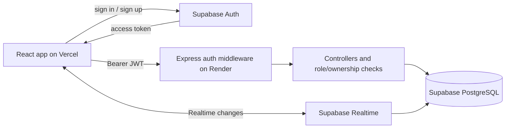
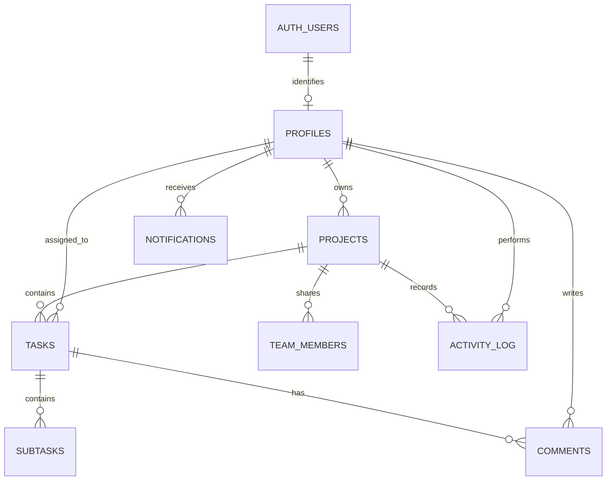

# NOVA

[](https://github.com/SatishBytes/Nova/actions/workflows/ci.yml)

NOVA is a full-stack project and task workspace built as part of a Full Stack Development <course/program name>. It combines a responsive React app with a Node/Express API and Supabase authentication and storage.

**Live app:** [nova-eta-swart.vercel.app](https://nova-eta-swart.vercel.app)

## Features

- **Workspace:** projects, templates, archive/restore, dashboard insights, and cross-project My Tasks.
- **Task planning:** Kanban and list views, drag-and-drop ordering, task details, priorities, due dates, labels, progress, and subtasks.
- **Collaboration:** owner/member/viewer roles, invitations, assignees, comments, activity history, notifications, and Supabase Realtime updates.
- **Productivity:** theme selection, keyboard shortcuts, command palette, filters, and optional AI task suggestions.
- **Reliability:** route-level code splitting, PWA app-shell caching, offline notice/fallback, and update prompts.
- **Accessibility:** keyboard interactions, visible focus states, reduced-motion support, and responsive layouts.

Private project data and API responses are not cached for offline use. AI suggestions are unavailable unless enabled on the backend.

## Screenshots

Replace these placeholders with current product captures:


## Tech stack

| Area | Technologies |
|---|---|
| Frontend | React 19, Vite, Tailwind CSS v4, Motion, dnd-kit, Recharts, Sonner |
| Backend | Node.js, Express 5, CommonJS, Supabase JavaScript client |
| Data and auth | Supabase Auth, PostgreSQL, Row Level Security, Supabase Realtime |
| Deployment | Vercel (frontend), Render (API), Supabase (auth/database) |
| Quality | ESLint, Vitest, React Testing Library, Supertest, GitHub Actions |

## Architecture



The backend uses a Supabase service key, which bypasses database RLS. API controllers therefore enforce project roles and ownership; RLS policies remain defense-in-depth for direct client access and future integrations.

## Database schema

Apply migrations only after the base Supabase schema exists (`projects`, `tasks`, and `team_members`, including the columns used by the app):

1. `supabase/migrations/002_tasks_upgrade.sql`
2. `supabase/migrations/003_collaboration.sql`
3. `supabase/migrations/004_productivity.sql`
4. `supabase/migrations/006_production_hardening.sql`

The base schema migration and migration 005 are not present in this checkout.
Verify that the base schema already exists before running these migrations.
Test each migration in a staging Supabase project first; do not apply a later
migration before its prerequisites. See the [production checklist](docs/PRODUCTION_CHECKLIST.md).



The diagram reflects the base tables assumed by these migrations and the relations they add. `team_members.user_id` may be null for pending invitations; task assignees and activity actors may also be null.

## Roles and permissions

| Capability | Owner | Member | Viewer |
|---|:---:|:---:|:---:|
| Read project, tasks, team, comments, and activity | Yes | Yes | Yes |
| Create, edit, reorder, and delete tasks; comment | Yes | Yes | No |
| Invite/remove members and change roles | Yes | No | No |
| Edit project settings; archive or restore project | Yes | No | No |

Project owners can manage all project settings. Shared project access is granted through an active `team_members` row.

## API overview

All `/api` endpoints except `/health` require a Supabase bearer token unless otherwise noted. `Owner` and `Member` mean that role or higher; `Viewer` includes all project roles.

| Method | Path | Access |
|---|---|---|
| GET | `/health` | Public |
| GET | `/api/projects` | Authenticated projects |
| POST | `/api/projects` | Authenticated |
| GET | `/api/projects/archived` | Owner |
| GET | `/api/projects/:id` | Viewer |
| PATCH | `/api/projects/:id` | Owner |
| DELETE | `/api/projects/:id` | Owner (archives) |
| POST | `/api/projects/:id/restore` | Owner |
| GET | `/api/projects/:projectId/activity` | Viewer |
| GET | `/api/tasks/project/:projectId` | Viewer |
| POST | `/api/tasks` | Owner / Member |
| POST | `/api/tasks/reorder` | Owner / Member |
| PATCH, DELETE | `/api/tasks/:id` | Owner / Member |
| POST | `/api/tasks/:id/subtasks` | Owner / Member |
| PATCH, DELETE | `/api/subtasks/:id` | Owner / Member |
| GET, POST | `/api/tasks/:id/comments` | Viewer (read); Owner / Member (write) |
| GET | `/api/team/project/:projectId` | Viewer |
| POST | `/api/team` | Owner |
| PATCH, DELETE | `/api/team/:id` | Owner |
| GET | `/api/notifications` | Authenticated user |
| PATCH | `/api/notifications/read-all`, `/api/notifications/:id/read` | Authenticated user |
| POST | `/api/ai/generate-tasks` | Owner / Member; optional |
| GET | `/api/dashboard/summary` | Authenticated user |

## Environment variables

Copy the example files to local `.env` files; never commit those local files. The examples contain placeholders only.

### Frontend (`frontend/.env.example`)

| Variable | Description |
|---|---|
| `VITE_SUPABASE_URL` | Supabase project URL |
| `VITE_SUPABASE_KEY` | Supabase publishable/anon key |
| `VITE_API_URL` | Express API base URL, including `/api` |
| `VITE_DEMO_LOGIN_ENABLED` | Set to `true` to show the demo login option |
| `VITE_DEMO_EMAIL` | Demo account email, only when demo login is enabled |
| `VITE_DEMO_PASSWORD` | Demo account password, only when demo login is enabled |
| `VITE_AI_ENABLED` | Set to `true` to show the AI task suggestion control |

### Backend (`backend/.env.example`)

| Variable | Description |
|---|---|
| `SUPABASE_URL` | Supabase project URL |
| `SUPABASE_KEY` | Server-side Supabase service key; keep private |
| `PORT` | HTTP port (defaults to `5000`) |
| `FRONTEND_URL` | Optional comma-separated additional CORS origins |
| `AI_ENABLED` | Set to `true` to enable task suggestions |
| `ANTHROPIC_API_KEY` | Optional server-only key required when AI is enabled |
| `UPSTASH_REDIS_REST_URL` | Optional Upstash REST URL for shared rate limits and caching |
| `UPSTASH_REDIS_REST_TOKEN` | Optional Upstash REST token; keep private |
| `CACHE_ENABLED` | Optional; defaults to enabled when Redis is configured; set to `false` to disable response caching |

## Local development

1. Create a Supabase project and configure authentication.
2. Apply the migration files in the order above. Confirm the pre-existing base schema matches the app’s project/task/team tables.
3. Copy the frontend and backend example files to their respective `.env` files and fill in local values.
4. Install and start the API:

   ```sh
   cd backend
   npm ci
   npm run dev
   ```

5. In another terminal, install and start the app:

   ```sh
   cd frontend
   npm ci
   npm run dev
   ```

The Vite app runs at `http://localhost:5173`; the API defaults to `http://localhost:5000`. The backend allows localhost and the production frontend origin; add any additional origin to `FRONTEND_URL`.

## Deployment

1. Deploy `frontend/` to Vercel and set its `VITE_*` variables in the project settings.
2. Deploy `backend/` to Render with the start command `npm start`; set `SUPABASE_URL`, `SUPABASE_KEY`, `PORT` (if required), and `FRONTEND_URL` to the frontend origin. Set `AI_ENABLED` and `ANTHROPIC_API_KEY` only if you intend to use AI suggestions.
   Configure `UPSTASH_REDIS_REST_URL` and `UPSTASH_REDIS_REST_TOKEN` to enable shared rate limits and response caching. If either is missing or Redis becomes unavailable, requests continue using in-memory rate limits and caching is skipped. Set `CACHE_ENABLED=false` to turn off caching while retaining Redis rate limiting.
3. Configure Supabase Auth’s allowed redirect URLs for the deployed app and local development URL.
4. Confirm Vercel deep links resolve through `frontend/vercel.json`, then test the API’s `/health` endpoint.

Render's free plan may take **30–60 seconds** to wake after inactivity. An external uptime pinger can request `/health` periodically if you want to reduce cold starts; no pinger is configured by the app.

## Tests and builds

```sh
cd frontend
npm run lint
npm test
npm run build

cd ../backend
npm test
npm start
```

GitHub Actions runs frontend lint, tests, and build plus backend tests on pushes and pull requests. The tests use dummy configuration and do not require real Supabase or AI credentials.

## Security notes

- Never put `SUPABASE_KEY` or `ANTHROPIC_API_KEY` in frontend variables or source.
- Authenticated API requests use a bearer token; controllers verify role/ownership before database operations.
- CORS is restricted to the configured frontend origins. The API also applies request-size limits, Helmet headers, and rate limits.
- Upstash rate limits use fixed windows with analytics disabled. Authenticated reads use one Redis command; writes use two (general plus write), and invite/comment/AI actions use three. The existing per-IP in-memory guard remains in place. Cache hits add two Redis commands and misses add three. Mutations increment a cache version for each affected user. This conservative usage helps control Upstash's free-plan command budget (500,000 commands/month); monitor actual traffic in Upstash.
- Redis requests have a short timeout and fail open. Redis outages fall back to per-instance in-memory limits, so rate-limit state is no longer shared until Redis recovers. Only the dashboard summary and project list are cached; task lists and permission checks remain uncached.
- Offline mode caches the app shell and static assets only. API calls, Supabase requests, auth responses, and private project records are network-only.
- AI task generation is disabled unless `AI_ENABLED=true` and a server-side provider key is configured.

## Known limitations

- The migrations extend an existing base schema; this repository does not include the initial project/task schema migration.
- Offline mode does not support viewing or editing private workspace data.
- Notifications are in-app only; browser push notifications are not configured.
- The AI integration depends on an external provider and is optional.

## Roadmap

- Add broader automated coverage for collaboration, realtime reconnects, and offline/update scenarios.
- Replace the screenshot placeholders with current captures and continue validating installability/accessibility across devices.
- Revisit the initial database schema migration and deployment workflow as the project evolves.
